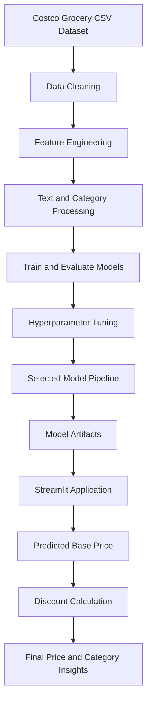

# 🛒 Costco Grocery Price Prediction & Analytics

<p align="center">
  <strong>An ML-powered grocery price estimation and analytics platform</strong>
  <br />
  Predict product prices, simulate promotional discounts, and compare prices across grocery categories using machine learning.
</p>

<p align="center">
  
  
  
  
  
</p>

---

## 📌 Table of Contents

- [Overview](#-overview)
- [Key Features](#-key-features)
- [Technology Stack](#-technology-stack)
- [System Architecture](#-system-architecture)
- [Dataset](#-dataset)
- [Machine Learning Workflow](#-machine-learning-workflow)
- [Model Evaluation](#-model-evaluation)
- [Web Application](#-web-application)
- [Project Structure](#-project-structure)
- [Installation](#-installation)
- [Usage](#-usage)
- [Limitations](#-limitations)
- [Future Improvements](#-future-improvements)
- [Disclaimer](#-disclaimer)

---

## 🎯 Overview

The **Costco Grocery Price Prediction & Analytics App** is a machine learning project that estimates grocery product prices using product information, category, quantity, ratings, and textual descriptions.

The project combines data preprocessing, feature engineering, regression models, hyperparameter tuning, and an interactive Streamlit dashboard into a single workflow.

It is designed to explore how machine learning can support price estimation, promotional pricing analysis, and category-level price comparisons in a wholesale grocery catalog.

### 💡 Problem Statement

Grocery products vary significantly in price because of differences in brand, quantity, packaging, product category, and specifications. Bulk and premium products can also have prices substantially higher than everyday groceries.

Estimating prices from product information is challenging because:

- Product descriptions are often unstructured.
- Product sizes and quantities use different units.
- Grocery categories have different price distributions.
- Promotional discounts can complicate price comparisons.
- High-priced products create a highly skewed price distribution.

### ✅ Proposed Solution

This project builds a regression-based price prediction pipeline that extracts useful information from product attributes and text, estimates a baseline price, and provides interactive tools for exploring discounts and category benchmarks.

### 🎯 Project Objectives

- Estimate grocery product prices using machine learning.
- Extract useful features from product titles and descriptions.
- Compare multiple regression algorithms.
- Reduce the effect of extreme prices using logarithmic target transformation.
- Evaluate model performance using standard regression metrics.
- Simulate promotional discounts.
- Visualize product prices and model insights through Streamlit.

---

## ✨ Key Features

| Feature | Description |
|---|---|
| 🧠 Price Prediction | Estimates product prices from available product attributes. |
| 🧹 Data Preprocessing | Cleans price values, missing data, and inconsistent formats. |
| 🔎 Feature Engineering | Extracts quantities, weights, text features, and category information. |
| 📊 Model Comparison | Evaluates multiple regression algorithms. |
| ⚙️ Hyperparameter Tuning | Uses Optuna to search for improved model configurations. |
| 🏷️ Discount Simulator | Calculates final prices after dollar or percentage discounts. |
| 📈 Category Benchmarking | Compares predicted prices with category-level distributions. |
| 🎯 Prediction Intervals | Displays empirical uncertainty intervals where supported by the trained pipeline. |
| 🖥️ Interactive Dashboard | Provides product inputs, visualizations, and model insights. |

---

## 🧰 Technology Stack

| Technology | Purpose |
|---|---|
| Python | Core programming language |
| Pandas & NumPy | Data manipulation and numerical operations |
| Scikit-learn | Preprocessing, regression, and model evaluation |
| TF-IDF | Text feature extraction |
| Truncated SVD | Dimensionality reduction |
| Optuna | Hyperparameter optimization |
| Joblib | Model serialization |
| Streamlit | Interactive web interface |
| Plotly | Interactive charts |
| Matplotlib | Exploratory data visualizations |
| LightGBM & XGBoost | Additional regression candidates |

The exact dependencies and versions are defined in `requirements.txt`.

---

## 🏗️ System Architecture

The application follows a data-to-prediction workflow.



### Workflow Explanation

1. **Data Collection:** Load the scraped grocery catalog.
2. **Data Cleaning:** Parse prices and handle missing values and invalid records.
3. **Feature Engineering:** Extract quantities, text information, ratings, and categories.
4. **Model Training:** Compare regression algorithms using cross-validation.
5. **Model Selection:** Tune and evaluate a candidate model.
6. **Artifact Export:** Save the trained pipeline and associated metadata.
7. **Inference:** Accept product details and generate a price estimate.
8. **Visualization:** Display pricing results, discounts, uncertainty, and category comparisons.

---

## 📦 Dataset

The project uses a scraped Costco grocery catalog stored in CSV format.

**Expected dataset files:**

- `costco_grocery.csv`
- `GroceryDataset.csv` (an alternative filename referenced in the original project)

### Dataset Summary

| Property | Reported Value |
|---|---:|
| Initial records | 1,757 |
| Final cleaned records | 1,752 |
| Original columns | 8 |
| Distinct subcategories | 19 |
| Products with reported discounts | 126 |
| Missing or unavailable ratings | Approximately 61.2% |

These statistics are based on the project's existing documentation and should be verified against the actual CSV file.

### Main Attributes

| Column | Description |
|---|---|
| `Title` | Product name |
| `Sub Category` | Grocery product category |
| `Price` | Product price |
| `Discount` | Promotional discount information |
| `Rating` | Customer rating information |
| `Currency` | Currency representation |
| `Feature` | Product highlights or specifications |
| `Product Description` | Detailed product information |

### Data Cleaning

The preprocessing workflow addresses:

- Conversion of formatted price strings into numerical values.
- Resolution of price ranges using their midpoints.
- Removal of records with missing prices.
- Removal of scraper error pages.
- Extraction of rating values and review counts.
- Creation of missing-rating indicators.
- Analysis of high-priced products and skewed price distributions.

High-priced products are retained when they represent legitimate products rather than data errors.

---

## 🧪 Machine Learning Workflow

### 1. Feature Engineering

The preprocessing pipeline combines numerical, categorical, and text-based features.

**Numerical features**
- Product weight
- Item quantity
- Pack count
- Title and description length
- Rating and review information

**Categorical features**
- Grocery subcategory
- Product classification indicators

**Text features**
- Product title
- Product features
- Product description

A custom `UnitFeatureExtractor` is used to derive product quantities and other attributes from text, according to the original implementation.

### 2. Text Processing

TF-IDF transforms product text into numerical features.

The documented configuration includes:

- Unigrams and bigrams
- `max_features=4000`
- `min_df=2`
- English stop-word removal

Truncated SVD then reduces the resulting feature space to 50 components.

### 3. Target Transformation

Product prices have a right-skewed distribution, with a small number of expensive products.

The training target is transformed using:

\[
y' = \log(1+y)
\]

The predicted value is converted back to the original price scale:

\[
\hat{y} = \exp(\hat{y}')-1
\]

This can reduce the influence of extreme values during model fitting, although it does not eliminate prediction errors.

### 4. Regression Algorithms

The project compares the following algorithms:

- Random Forest Regression
- Gradient Boosting Regression
- Ridge Regression
- LightGBM
- XGBoost

Five-fold cross-validation is used in the documented training workflow.

### 5. Hyperparameter Optimization

Optuna is used to search for promising Random Forest configurations.

Reported parameters include:

```python
{
    "n_estimators": 160,
    "max_depth": 24,
    "min_samples_split": 2,
    "min_samples_leaf": 1,
    "max_features": 0.468,
    "n_components": 50
}
```

These are the documented settings and should be checked against the actual saved model and training script.

### 6. Data Leakage Prevention

The selected baseline-price prediction approach excludes promotional discount information from the model inputs.

This allows the model to estimate a baseline price independently of a discount that may be unknown at prediction time.

The discount simulator applies the supplied promotion after the base price has been predicted.

---

## 📊 Model Evaluation

The following are the **reported results** from the original project documentation, not independently verified benchmark results.

### Reported Model Comparison

| Model | Variant | CV R² (log) | Test MAE | Test RMSE | Test MAPE | Test R² |
|---|---|---:|---:|---:|---:|---:|
| Random Forest (Tuned) | B | 0.8994 | $23.00 | $91.76 | 23.52% | 0.8654 |
| Random Forest (Base) | B | 0.8443 | $23.12 | $93.75 | 23.73% | 0.8655 |
| Gradient Boosting | B | 0.8462 | $24.71 | $98.12 | 24.46% | 0.8535 |
| Ridge Regression | B | 0.8173 | $25.29 | $107.03 | 27.10% | 0.8248 |
| LightGBM | B | 0.8247 | $25.96 | $109.15 | 27.07% | 0.8186 |
| XGBoost | B | 0.8378 | $26.11 | $109.28 | 26.96% | 0.8183 |

**Metrics at a glance**

- **MAE:** Mean Absolute Error
- **RMSE:** Root Mean Squared Error
- **MAPE:** Mean Absolute Percentage Error
- **R²:** Coefficient of Determination

Lower MAE and RMSE generally indicate smaller prediction errors. Higher R² indicates a better fit relative to a baseline that predicts the target mean.

> **Evaluation note:** The reported tuned Random Forest cross-validation score differs from the base model's score, while their reported test scores are nearly identical. Confirm the metric calculations, target scale, data splits, and saved artifacts before drawing a final conclusion about which model performs best.

### Prediction Intervals

The application is documented as providing 80% and 90% empirical prediction intervals based on validation residuals.

These intervals represent estimated uncertainty rather than guaranteed minimum and maximum prices. Their actual coverage should be measured on unseen data.

---

## 🖥️ Web Application

The Streamlit application is implemented in `app.py`.

### Interactive Product Inputs

- Product title
- Grocery subcategory
- Customer rating
- Missing-rating selection
- Product features
- Product description

### Quick-Fill Templates

The documented interface includes templates for:

- Olive Oil
- Salmon Case
- Prebiotic Soda
- Caviar

### Price and Discount Analysis

The application is designed to display:

- Predicted base price
- Applied discount
- Final estimated price
- Prediction intervals
- Category-level price comparisons

For a fixed-dollar discount:

\[
P_f = \max(0.50,\ P_b-D)
\]

For a percentage discount \(d\):

\[
P_f = \max\left(0.50,\ P_b\left(1-\frac{d}{100}\right)\right)
\]

Where:

- \(P_f\) = Final estimated price
- \(P_b\) = Predicted base price
- \(D\) = Fixed-dollar discount
- \(d\) = Percentage discount

These formulas assume a minimum price of $0.50. The application should validate discount inputs and prevent invalid percentages.

### Visual Analytics

The documented dashboard includes:

- Interactive Plotly category boxplots
- Model performance comparisons
- Feature importance visualizations
- Exploratory data analysis charts

---

## 📁 Project Structure

```text
store/
│
├── data/
│   └── costco_grocery.csv
│
├── notebooks/
│   ├── costco_price_prediction.ipynb
│   ├── train_eda_notebook.py
│   ├── generate_eda_plots.py
│   └── eda_plots/
│
├── src/
│   ├── __init__.py
│   ├── preprocessing.py
│   ├── train.py
│   └── predict.py
│
├── artifacts/
│   ├── model.joblib
│   ├── metadata.json
│   └── plots/
│
├── app.py
├── requirements.txt
└── README.md
```

### Important Files

| File | Responsibility |
|---|---|
| `app.py` | Streamlit user interface |
| `src/preprocessing.py` | Feature extraction and preprocessing |
| `src/train.py` | Model training and evaluation |
| `src/predict.py` | Prediction and inference logic |
| `artifacts/model.joblib` | Serialized trained model pipeline |
| `artifacts/metadata.json` | Model information and evaluation metadata |
| `requirements.txt` | Python dependencies |
| `notebooks/costco_price_prediction.ipynb` | Interactive analysis notebook |

The structure represents the documented project layout. Individual files and generated artifacts must exist in the repository for the corresponding commands to work.

---

## 🚀 Installation

### Prerequisites

- Python 3.10 or later
- Git (optional)
- A terminal or command prompt

### Step 1: Clone the Repository

If the project is hosted on GitHub:

```bash
git clone <YOUR_REPOSITORY_URL>
cd store
```

Alternatively, navigate directly to your existing project directory.

### Step 2: Create a Virtual Environment

**Windows PowerShell**

```powershell
python -m venv .venv
.\.venv\Scripts\Activate.ps1
```

**macOS / Linux**

```bash
python3 -m venv .venv
source .venv/bin/activate
```

### Step 3: Install Dependencies

```bash
python -m pip install --upgrade pip
pip install -r requirements.txt
```

Ensure that `requirements.txt` includes all required libraries and compatible versions.

---

## ▶️ Usage

### Option 1: Run the Existing Model

If the trained artifacts are already available:

```bash
streamlit run app.py
```

Open the application at:

**http://localhost:8501**

### Option 2: Train the Model

To execute the training pipeline:

```bash
python src/train.py
```

The script should generate the required model artifacts according to its implementation.

### Option 3: Run Standalone Prediction

```bash
python src/predict.py
```

This command works as a standalone program only if `src/predict.py` defines the appropriate executable entry point.

### Typical Workflow

1. Launch the Streamlit application.
2. Enter a product title and description.
3. Select the product category.
4. Provide rating and quantity details.
5. Generate a baseline price estimate.
6. Apply a simulated discount.
7. Review the final estimated price and category comparison.

---

## ⚠️ Limitations

### Dataset Coverage

The documented dataset contains approximately 1,752 cleaned records. It may not represent the full Costco catalog, all warehouse locations, or future price changes.

### Price Variation

Actual prices can vary by location, availability, delivery arrangements, and promotions.

### Prediction Accuracy

Model errors may be larger for premium, unusual, or poorly represented products. A strong R² does not mean every individual prediction is accurate.

### Discount Accuracy

The discount simulator calculates prices using user-provided inputs. It does not independently verify current Costco offers or membership eligibility.

### Prediction Intervals

Empirical prediction intervals require validation on representative unseen products. Their advertised coverage should not be assumed without calibration testing.

### Production Readiness

The project demonstrates an end-to-end ML workflow, but production deployment would require additional testing, monitoring, data validation, and operational safeguards.

---

## 🔮 Future Improvements

Potential extensions include:

- [ ] Add automatic dataset refresh and validation.
- [ ] Compare predictions across product categories and price ranges.
- [ ] Add model versioning and experiment tracking.
- [ ] Build an API for external applications.
- [ ] Add historical price tracking when longitudinal data becomes available.
- [ ] Evaluate performance on products from different locations.
- [ ] Monitor prediction errors and data drift.
- [ ] Add automated tests for preprocessing and inference.
- [ ] Improve uncertainty calibration and subgroup evaluation.
- [ ] Deploy the application to a cloud hosting platform.

These are proposed improvements, not claims about existing functionality.

---

## 📄 Disclaimer

This project is intended for educational, analytical, and demonstration purposes. Price predictions are estimates based on the available dataset and are not guaranteed to match current Costco prices.

The dataset is described as a scraped product catalog. Users should ensure that their data collection and use comply with applicable terms, permissions, and laws.

Costco is a registered trademark of Costco Wholesale Corporation. This project is not affiliated with or endorsed by Costco Wholesale Corporation.

---

<p align="center">
  <strong>Built with Python, Machine Learning, and Streamlit</strong>
  <br />
  Exploring grocery pricing through data and predictive analytics.
</p>
